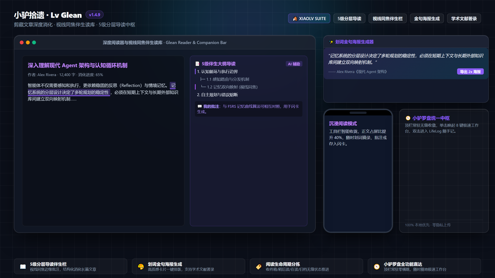

# 小驴拾遗 · Lv Glean

**围绕思源剪藏，提供候选确认、稍后读、阅读管理、收件箱分拣与长文深度读库中枢**

100% 数据主权 · 结构化阅读生命周期 · 视线同焦注记 · 划词金句海报 · 学术文献著录

**当前版本：v1.4.12** ｜ [English Documentation](README.en-US.md) ｜ [更新日志](CHANGELOG.md)

[⬇️ 下载安装](#-安装方式) · [🚀 快速上手](#-快速上手三步跑通第一个场景) · [🖥️ 面板指南](#-各面板用途与界面指南) · [⚙️ 设置参考](#-设置项全参考分类选项默认值业务影响) · [⌨️ 快捷键](#-全键盘极速工作流与快捷键一览) · [🔒 隐私说明](#-数据存放生命周期与本地优先隐私说明)

 

---

## 🚀 本次更新要点（v1.4.12）

> **全生态大重构正式版**：本次发布同步升级正式版本号至 `v1.4.12`，包含全部共享中枢协同、性能重构与体验修复：
- **阅读台预览态划词摘录与 Ghostreader 伴读**：支持在 `.protyle-preview` 预览态直接划词摘录为引述、4 色高亮、块批注、选区翻译与 Ghostreader 行内伴读问答，兼容思源原生只读属性（`custom-sy-readonly` / `custom-siyuan-readonly`），并修复阅读器切换 AI 任务时伴生栏 `AbortController` 误中止与图层穿透模态弹窗问题；
- **全 15 处 AI 与语义检索统一等待体验**：全仓 15 处 AI 与语义检索入口全面接入 `.lv-ai-thinking` 动态等待卡片与 `AbortSignal` 实时取消，消除浏览器端 `fetchSyncPost` 阻塞，伴生栏 5 格导航胶囊自适应防裁切；
- **四级折叠日记区写入与防冲突加固**：阅读足迹与今日拾遗必读计划统一写入当日日记 `#### 🐴 小驴记录` 折叠区（附带统一 LifeLog 属性），优先复用全库既有日记正身并双重过滤 `hpath` 冲突副本；
- **三大共享中枢深度融合**：接入小驴罗盘（顶栏直达拾遗主页与「今日阅读池 / 剪藏剪贴板 / 稍后读收件箱」次级行动）、全生态 AI 路由、块助手 1–8 原生底座与自定义双击触发、统一通知/活动总线与全生态联合灾备恢复；
- **零 `:has()` / 零高模糊 60fps 极速性能**：全量样式严格 0 `:has()`、0 全局 `:root` 变量泄露、0 `blur(≥15px)`，移除全局 `MutationObserver` 与冗余死模块，将 7 份轮转备份延后至冷启后空闲调度；
- **智能排版优化与 AI 批处理面板**：新增文章智能排版对比弹窗与 AI 批量富化工作台，并全面清理过期内部术语与历史内部标识。

展开查看历史版本更新记录（v1.4.11 及更早版本 · 完整记录见 CHANGELOG.md）

- **v1.4.11**：轮转备份延后调度、索引代际守卫与上下文过滤、冷启优化回归验证。

- **v1.4.8**：思源 3.8.10+ 原生适配（专注模式折叠停靠栏、原生文档树菜单）、标签别名 Escape 退出、移动端状态组修复。
- **v1.4.6**：顶栏右键快捷菜单官方化，罗盘与弹层层级接入全生态 Protocol v1.7.6 治理。
- **v1.4.5**：手机端完整体验闭环——罗盘双入口、全屏面板、五态快捷悬浮条。

---

## 🐴 小驴思源全家桶生态矩阵与交流

本插件为「小驴思源生态」8 大官方集市插件之一。所有插件共享小驴罗盘（顶栏常驻中枢）、全域穿透搜索与统一备份恢复：

| 插件名称 | 核心用途 | 官方集市 / 仓库 |
| :--- | :--- | :--- |
| **小驴打卡** | 本地优先习惯打卡、日程提醒与多维人生热力图工作台 | [`siyuan-checkin`](https://github.com/xiaolv-suite/siyuan-checkin) |
| **小驴管家** | 家庭成员中心视角档案、证照保单到期预警与 LifeLog 流水协同 | [`siyuan-home`](https://github.com/xiaolv-suite/siyuan-home) |
| **小驴人脉** | 一人一文档人际管理、圈层力导向关系网络与会前破冰速览 | [`siyuan-contacts`](https://github.com/xiaolv-suite/siyuan-contacts) |
| **小驴拾遗** | 剪藏文章深度消化、视线同焦伴生导读与 4 大学术著录 | [`siyuan-glean`](https://github.com/xiaolv-suite/siyuan-glean) |
| **小驴闪卡** | 原生 FSRS 算法调度、文档内质感序号流与全场景极速制卡 | [`siyuan-lv-cards`](https://github.com/xiaolv-suite/siyuan-lv-cards) |
| **小驴考试** | 全真模拟考场环境、错题靶向归因复训与苏格拉底启发式 AI 导师 | [`siyuan-exam`](https://github.com/xiaolv-suite/siyuan-exam) |
| **小驴常用** | 代码片段工作室、零卡死安全剪贴板历史与一键记事沙盒 | [`xiaolv-common`](https://github.com/xiaolv-suite/xiaolv-common) |
| **小驴雷切** | 毫秒级多文档穿透切换、左右双文档实时分栏对照与切片代码画板 | [`siyuan-speed-switch`](https://github.com/xiaolv-suite/siyuan-speed-switch) |

💬 **官方交流与需求反馈 QQ 群**：**871707735**（开发者实时在线，欢迎反馈问题、交流使用体验与提交新功能构想）。

---

## 🎯 插件定位与核心理念

小驴拾遗是思源笔记中**本地优先（Local-First）的稍后读（Read-it-Later）与长文深度消化中枢**，致力于终结“剪藏一时爽，收集即吃灰”的困境：

| 痛点场景 | 传统剪藏扩展 / 外部稍后读 App | 小驴拾遗解决方案 |
| :--- | :--- | :--- |
| **数据孤岛与服务停摆** | 剪藏到第三方商业服务器，排版失真、图片失效，更无法在笔记中双链串联 | **100% 数据主权**：基于思源原生文档属性（`custom-clip-*`），文章在本地笔记本内，卸载插件数据零损失 |
| **只存不读，死积如山** | 收集了几百篇文章却从未点开，收件箱越来越重导致心理负担爆棚 | **结构化 5 阶生命周期**：**收件箱 (Inbox) ➔ 稍后读 (Later) ➔ 阅读中 (Reading) ➔ 已读毕 (Done) ➔ 归档 (Archived)** |
| **读完没有沉淀产出** | 读完全文随手划线，过几天全忘，无法形成自己的卡片或结构化知识 | **深度伴读沉淀闭环**：视线同焦边距注记、划词胶囊一键制作金句海报卡片、一键流转到小驴闪卡（FSRS制卡） |
| **学术引文繁琐不标准** | 引用论文或行业报告时，格式杂乱，手动抄写引文作者与日期极其耗时 | **四大国际文献著录**：一键生成国标 GB/T 7714、BibTeX、APA、MLA 9th 规范学术引文与块引用反链 |

---

## ✨ 核心能力体系

- **📚 读库工作台（Library Workbench）**：表格、看板、卡片三大视图与自适应调宽分面侧栏（180-420px）；原生拖拽收纳制卡；支持空格多词逻辑与（AND）全文检索；导轨右键快捷菜单；全键盘二维方向键（`← / → / ↑ / ↓`）与 `h/j/k` 跨列流转；看板单列轻量虚拟化与独立分页；批量操作标签与作者变更 Diff 实时预估。
- **📖 沉浸伴读与多模块伴生（Companion Reader）**：三区平衡顶栏（左区元数据与人脉直达、中区阅读/编辑双态切换、右区阅读控制与一键「✓→ 读完并下一篇」）；伴生栏划分「大纲」「批注」「五阶分层」「AI 伴读」「工具」5 专一导航 Tab；预览态划词胶囊支持一键「摘录为引述」、4 色高亮、批注、**Ghostreader 行内伴读**、选区翻译、金句卡片与闪卡制作；内置**文章排版优化对比弹窗**与 **AI 批处理面板**；支持禅意全屏（`F11`）、5 阶语义折叠阅读（`Alt+Z`）与浏览端语音朗读高亮跟踪。
- **🐴 小驴生态深度联邦联动（Ecosystem Federation）**：与小驴闪卡（划线/摘要一键制卡与待复习跳转）、小驴人脉（作者档案识别与关联直达）、小驴常用（一键沉淀常用语话术）以及小驴打卡（阅读时长精准记入）全方位互通。
- **📱 移动端与全屏触控优化**：专为手机端打造的 100vw/100dvh 全屏阅读宿主，支持五态底部快捷条、Aa 排版滑块调节正文字号行距、手势下拉关闭与软键盘避让防误触。

---

## 📦 安装方式

1. **思源集市安装（推荐）**：打开思源笔记 `设置` → `集市` → `插件`，搜索 **「小驴拾遗」**（或 `siyuan-glean`），点击安装并启用；
2. **发行包手动安装**：
   - 从 [GitHub Releases](https://github.com/xiaolv-suite/siyuan-glean/releases/latest) 下载 `package.zip`；
   - 解压至思源工作空间的 `data/plugins/siyuan-glean` 目录；
   - 在思源笔记 `设置` → `插件` 中启用「小驴拾遗」。

---

## 🚀 快速上手：三步跑通第一个场景

1. **第一步：确认剪藏或将既有文章加入读库**：点击顶栏小驴罗盘中的「小驴拾遗」磁贴（或按 `Ctrl + Alt + G` / macOS `⌥⌘G`）打开读库，切换到「待分拣」，选择一篇你剪藏进思源的文章，点击卡片上的「加入读库」；
2. **第二步：沉浸伴读、划词批注与 Ghostreader**：进入伴读阅读器，在预览态直接选中正文精彩段落，即可使用划词胶囊一键「摘录为引述」、4 色高亮、添加「批注」或唤起 **Ghostreader** 进行行内伴读问答；
3. **第三步：一键完成并沉淀知识**：读毕点击右上角「✓→ 读完并下一篇」，文章自动推进至已读并记入当日日记 `#### 🐴 小驴记录` 折叠区；点击「金句卡片」导出高清图片，或点击「转为闪卡」生成间隔复习卡片。

---

## 🖥️ 各面板用途与界面指南

| 面板名称 | 入口 / 唤起方式 | 核心定位与业务场景 |
| :--- | :--- | :--- |
| **收件箱 (Inbox)** | 读库侧栏「📥 收件箱」 | 剪藏缓冲池：核对来源 URL、过滤噪点、提取元数据，确认后一键转入待读。 |
| **稍后读 (Later)** | 读库侧栏「⏳ 稍后读」 | 待消化书架：按优先级与预估阅读时长智能排序，支持批量标签归类与阅读计划排期。 |
| **阅读中 (Reading)** | 读库侧栏「📖 进行中」 | 当前主攻清单：记录断点续读位置、保留当前伴读边距注记与折叠进度。 |
| **读库总览 (Library)** | 顶栏小驴罗盘 / `Ctrl + Alt + G` | 全局文章资产大盘：列表/看板多视图切换，全文搜索、多维分面过滤与文献著录导出。 |
| **伴读阅读器 (Reader)** | 读库列表点击阅读 | 沉浸阅读中枢：三区顶栏、五专一伴生栏、禅意全屏、Aa 排版调节、排版优化弹窗与划词 Ghostreader。 |
| **批注墙 (Annotation Wall)** | 读库侧栏「🖍️ 批注墙」 | 全库灵感聚合区：集中查看所有文章的高亮、批注与划线，按颜色分流导出原子卡片。 |
| **阅读统计 (Stats)** | 读库侧栏「📊 统计洞察」 | 个人认知数据大盘：阅读字数、完读率、阅读时长热力图与认知领域分布。 |
| **漫游盲盒 (Stumble)** | 顶栏右键 / 快捷键 | 灵感偶遇器：在已读库与稍后读中随机漫游抽取一篇高价值旧文，打破信息茧房。 |

---

## ⚙️ 设置项全参考（分类/选项/默认值/业务影响）

| 分类 | 设置项名称 | 配置键 | 默认值 | 业务影响与推荐说明 |
| :--- | :--- | :--- | :---: | :--- |
| **工作区与存储** | 读库锚点笔记本 | `anchorNotebooks` | `[] (空)` | 仅扫描勾选笔记本中的剪藏来源证据，不污染其他私人笔记 |
| **每日拾遗** | 每日推荐篇数 | `resurface.dailyCount` | `3` | 每日在「今日拾遗」优先推荐的待读篇数（建议 3–5 篇） |
| **阅读体验** | 在编辑器页签打开 | `reader.openInTab` | `false` | 关闭时以独立沉浸浮窗打开，开启时作为思源主编辑区页签打开 |
| **阅读体验** | 阅读器默认模式 | `reader.defaultMode` | `"read"` | `"read"` 为伴读预览态（支持划词摘录/Ghostreader），`"edit"` 为原生编辑态 |
| **AI 增强** | AI 富化模式 | `ai.enrichMode` | `"manual"` | 默认仅手动触发（`"off"` / `"manual"` / `"auto"`），严守零静默外发 |
| **AI 增强** | 选区提问 / Ghostreader | `ai.articleQuestionEnabled` | `false` | 开启后支持在伴读中针对全文或选区发起 Ghostreader 行内问答 |
| **AI 通道** | AI 服务通道 | `ai.channel` | `"siyuan"` | `"siyuan"` 直连思源内置 AI，`"custom"` 支持自定义 OpenAI 兼容接口（密钥存思源密钥库） |

---

## ⌨️ 全键盘极速工作流与快捷键一览

| 快捷键 | 功能描述 | 适用上下文 |
| :--- | :--- | :--- |
| `Ctrl + Alt + G` / `⌥⌘G` | 快速唤出 / 切换小驴拾遗读库工作台 | 思源全局任意界面 |
| `Alt + P` | 打开小驴拾遗设置弹窗 | 思源全局任意界面 |
| `/` 或 `Ctrl + F` | 快速聚焦读库搜索框（支持空格多词 AND 搜索） | 拾遗读库面板内 |
| `1` ~ `5` | 快速为当前聚焦文章标记 1~5 星评分 | 读库列表 / 伴读器 |
| `Alt + Z` | 开启 / 关闭 5 阶语义大纲折叠阅读模式 | 伴读阅读器内 |
| `F11` | 进入 / 退出禅意全屏阅读模式（Zen Mode） | 伴读阅读器内 |
| `D` | 将当前文章标记为已读并跳至下一篇 | 伴读阅读器内 |
| `Esc` | 安全退出搜索、收起伴生栏或关闭读库窗口 | 全局浮层 |

---

## 🔒 数据存放、生命周期与本地优先隐私说明

- **本地存储位置**：`data/storage/petal/siyuan-glean/`
  - `settings.json`：工作区锚点、伴读排版偏好与 AI 开关配置；
  - `glean-index.json`：读库派生索引缓存（可随时由文档属性重建）；
  - `candidates.json`：剪藏收件箱候选队列；
  - `daily-backup-index.json`：每日轮转快照索引；
  - `ai-usage.json` / `ai-batch.json`：AI 用量记录与批处理作业日志。
- **批注不另存索引**：边距注记与高亮批注本身是原生思源块（元数据 `custom-clip-*`），随文档保存，不存在 `annotations.json` 这类跨文档索引文件。
- **正文纯本地**：所有被拾遗管理文章均为思源原生文档，元数据通过标准块属性（`custom-clip-*`）存储，随工作空间自由备份。
- **零遥测与网络安全**：无任何外部服务器回传。AI 摘要、TTS 朗读与翻译能力完全在本地运行或按需调用思源内置 AI 接口。

---

## ❓ 常见问题与故障排查 (FAQ)

- **Q1：拾遗会自动把我的所有笔记变成文章吗？**  
  **答：绝对不会。** 拾遗坚守“明确确认”原则：每篇文章都需用户点击「收录」或符合用户自定义的剪藏规则才会纳入管理，普通生活笔记绝不被污染。
- **Q2：如果以后停用或卸载拾遗插件，我的文章和批注会丢失吗？**  
  **答：完全不会丢失。** 文章本体始终是标准的思源笔记文档，划线与批注也是原生思源块。即使彻底删除插件，文档依然完好、内容零损失。
- **Q3：手机端打开文章后，工作台会挡在前面吗？**  
  **答：不会。** 当前版本已实现移动端全屏工作台优雅退场：点击具体文章后，工作台自动收起，底层笔记即刻呈现，无需手动二次关闭。

---

## 社区反馈与开发指南

请通过 [GitHub Issues](https://github.com/xiaolv-suite/siyuan-glean/issues/new/choose) 提交反馈，并附上思源版本、插件版本、前端类型和可复现步骤。截图或日志请先移除标题、正文、URL 和密钥等隐私内容。

- 完整开发与测试规范：阅读 [AGENTS.md](AGENTS.md) 与 [CONTRIBUTING.md](CONTRIBUTING.md)
- 能力边界与环境矩阵：参考 [docs/CAPABILITY-MATRIX.md](docs/CAPABILITY-MATRIX.md)
- 真实宿主与已知阻塞：参考 [docs/ACCEPTANCE.md](docs/ACCEPTANCE.md) 与 [docs/BLOCKERS.md](docs/BLOCKERS.md)
- 源码工程构建与交付：需要 Node.js `>=24` 和 pnpm，常用命令 `pnpm check`、`pnpm test`、`pnpm build`

---

## 许可证 (License)

[MIT](LICENSE)
